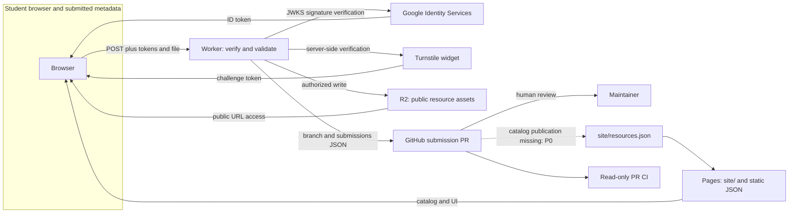

# Cloud Computing foundation

This records source behavior, not a production inspection. Baseline and recovery
evidence are in [the audit](../../audit.md); local commands and proposed release
steps are in [operations](../../operations.md).

## Architecture and trust boundaries



Browser and submission metadata are untrusted. Google signatures establish an
identity; Worker issuer/audience/time/email/domain checks authorize students.
Turnstile is an additional abuse check. CORS restricts browser origins but is
not an authentication mechanism. Storage and repository write credentials
belong only to the Worker. Public resources have no per-download authorization.
The current PR adds submission JSON only; merging it does not publish a catalog
entry. Scheduled cleanup is absent. The dotted publication path is planned.

## Service inventory

| Service | Purpose/component | Permissions and data | Dependency, limitations and cost factors |
| --- | --- | --- | --- |
| Pages/CDN | `site/`, JSON and UI | Public reads; deployment privileges separate | Static cache/distribution; live configuration unverified; traffic/build limits |
| Workers | `worker/worker.ts` | Student-token/Turnstile checks; backend secrets; bounded uploads | Edge execution, memory/CPU/body limits, upstream timeouts; request/CPU pricing |
| R2 | `BUCKET` binding | Backend writes/deletes; public-read files | Storage/object-operation costs; deletion/reconciliation absent; live policy unverified |
| Google GIS/JWKS | Browser sign-in and Worker key verification | Public client ID, transient ID token | External identity availability and OAuth-origin settings |
| Turnstile | Browser challenge and Worker verification | Public site key, secret server key, client IP sent for verification | Third-party availability and configured hostnames |
| GitHub | Submission branches/PRs and source | Repository contents/PR write token; submitted metadata and asset URL | API/token limits, failure rollback uncertainty, publication missing |
| Actions/Dependabot | This branch's CI and updates | Read-only checks; no production secrets | Hosted runner minutes and update limits; requires merge before default-branch operation |
| Frontend CDNs | Existing Tailwind/fonts and external scripts | Browser third-party requests | Availability, browser privacy and supply-chain review remain launch work |

No real request counts, storage usage, pricing tier or expenditure were measured.
Estimate cost using provider documentation current at report time and assumed
requests, CPU time, stored GB, R2 operations and Actions minutes. State assumptions
and distinguish estimates from bills. No paid infrastructure is introduced.

## Why serverless / scaling and failure behavior

Static hosting/CDN and Workers avoid maintaining an application server. Workers
execute request handlers at the edge; R2 stores objects independently of Worker
instances. Catalogs remain static Git data without an application database.
Edge delivery can reduce geographic latency, while authentication, Turnstile,
R2 and GitHub still add remote service latency and availability dependencies.

Downloads scale separately from submissions. Large multipart bodies are bounded
at 25 MiB, with a 24 MiB frontend file allowance. Upload bytes are buffered and
GitHub needs multiple API calls per submission, so body/memory limits, API rate
limits and branch/catalog concurrency can constrain scale before static hosting.
No throughput, cold-start benefit, availability percentage or scalability claim
has been experimentally established.

Source failure handling: missing configuration fails closed; Google upstream
errors can yield 503; other dependencies yield sanitized errors; GitHub failure
attempts R2 rollback. Failed deletion is swallowed and there is no cleanup job.
Public storage can expose abandoned uploads even if they never enter the catalog.
Publication and cleanup must be resolved before calling this lifecycle reliable.

## Safe reproducible measurement

The bounded helper allows only loopback targets and rejects external redirects;
local redirects are recorded without following them. It sends
at most 20 sequential requests, at intervals of at least 0.2 seconds, with a
2-second default timeout and a 1 MiB read cap. It never sends credentials/files.

```sh
# In another terminal, serve static fixtures/site locally:
python3 -m http.server 8000 --directory site
# Local latency, not Cloudflare production latency:
python3 scripts/measure_local.py http://127.0.0.1:8000/courses.json --count 5 --output work/courses-latency.json
python3 -m unittest discover -s scripts/tests -v
```

The same helper can measure an explicitly configured local Worker with
`--method POST --origin http://localhost:8000`; missing authentication should
reject. It cannot exercise successful uploads without a separate fixture harness.
HTTP fixture tests measure 200/503 responses and block external redirects.
Worker Node tests cover origins, preflight, method/route, malformed/missing auth,
and missing configuration; they are not deployed-edge measurements.

Future isolated local/workerd experiments: signed test JWTs and mocked JWKS,
wrong-domain rejection, failed Turnstile, 25 MiB body limit, valid tiny asset,
R2/GitHub faults, rollback, and bounded concurrent moderation PRs. Record
status correctness, zero unauthorized writes, timeouts, and recovery behavior.
Actual Google or Cloudflare challenge requests must not be attacked or replaced
in production. Staging resource/download and modest-load tests require explicit
owner authorization, test-only objects, agreed rate caps and cleanup safeguards.

## Measurement and report template

For each experiment, record:

| Field | Value to supply |
| --- | --- |
| Commit, tool/runtime versions, command | Exact tested versions and invocation |
| Environment / fixture / authorization | Local, isolated staging, or explicitly authorized production |
| Samples, request interval, byte cap and timeout | Exact test parameters |
| Status / correctness / bytes / durations | Raw saved output, error count, median/p95 if sample size supports it |
| Cache state, region, cold/warm state | Observed evidence or unknown |
| Fault and recovery | Injected local fault, response, residual objects/branches |
| Interpretation and limitation | Include local timing and sample-size limitations |

Suggested report: objective; implemented architecture/diagram; infrastructure and
configuration without secrets; deployment/rollback method; experiment design;
results with raw output references; reliability/failure evaluation; scaling and
cost estimates; security/tradeoffs; limitations and future work. No assignment
rubric was provided. Obtain it before finalizing report structure or experiments.
