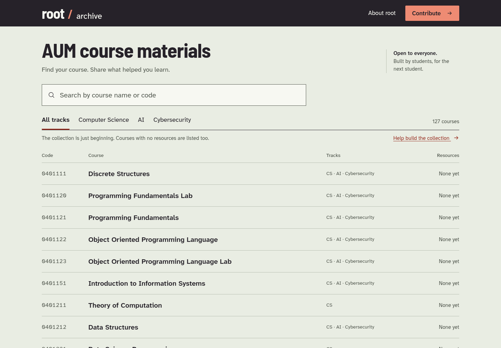
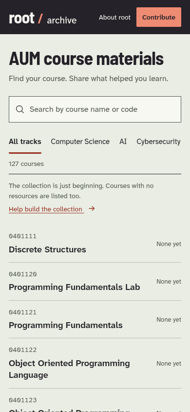
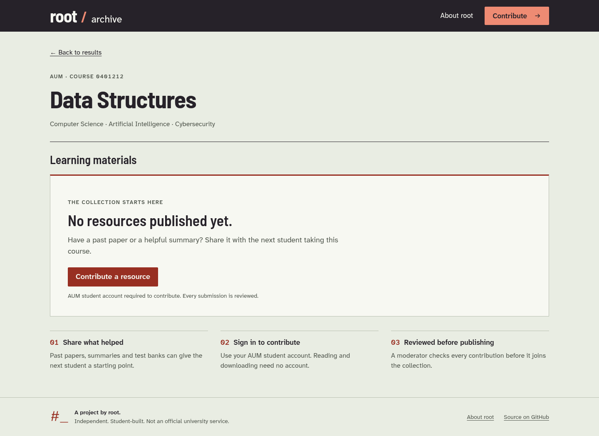
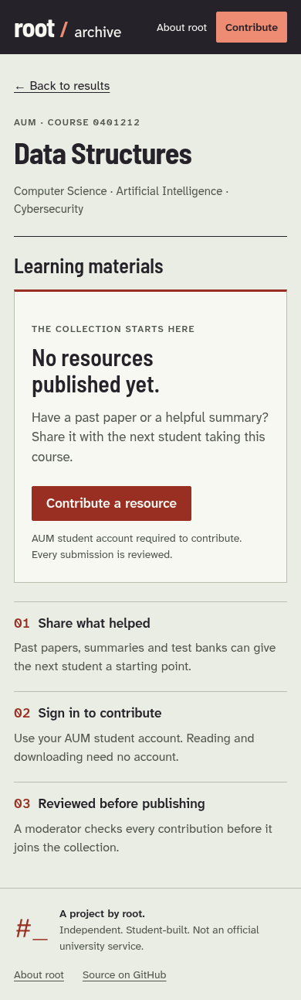
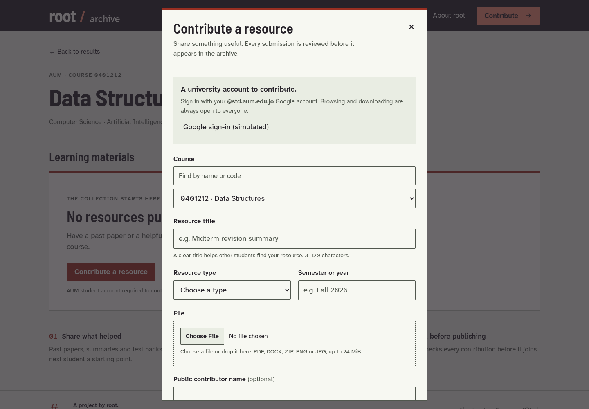
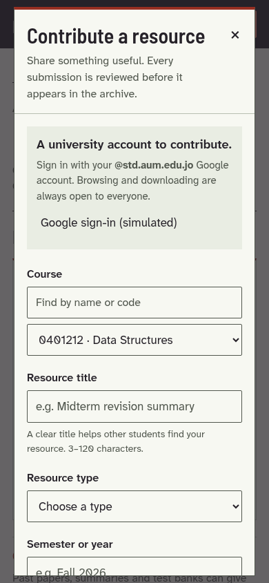

# Frontend overhaul

This change replaces the terminal-style, accordion catalog with a mineral-green
directory and dedicated course destinations. It is based on `ab6f1d6` (the merge
of moderation PR #22). Neither public catalog, Worker code, storage behavior nor
submission/moderation workflows are changed.

## Navigation and architecture

The static site still deploys directly from `site/`, without a build step or
runtime dependencies. `index.html` supplies semantic page/dialog structure;
`styles.css` owns the palette, self-hosted typography and responsive layouts.

| Module | Responsibility |
| --- | --- |
| `js/app.mjs` | Directory/course/About rendering, filters and browser history |
| `js/catalog.mjs` | Published catalog validation, search, URL and file helpers |
| `js/dom.mjs` | Text-safe DOM, links, SVG arrows and focus helpers |
| `js/config.mjs` | Existing public integration settings and supported contracts |
| `js/services.mjs` | Google sign-in/Worker verification and Turnstile |
| `js/contribution.mjs` | One contribution dialog, in-memory draft and submission |

Course URLs use `/?course=0401212`. Query parameters are a deliberate static
hosting choice: direct visits and reloads request the existing index on
Cloudflare Pages, with no rewrite rules or framework router. Directory state
uses `?q=data&track=CS`; course links retain these parameters for a meaningful
return path even in a new tab. About uses `?view=about`. Leading zeros survive.

Internal left-click navigation uses the History API. Native links still support
new tabs, copying and modified clicks. Each history entry saves its scroll and
focus target before navigation; Back/Forward restores these alongside the query
and track. The explicit return link uses browser Back when its prior entry is the
directory, or the query/filter URL on direct visits. Document titles identify
the current course. No credentials or draft fields enter history or web storage.

The directory retains all 127 real courses, including empty courses. Resource
counts come only from the published `resources.json` (currently empty). Materials
are grouped by the four existing types; an additional type filter appears only
for collections of at least 12 resources spanning multiple types. Public HTTPS
resource links open directly, without sign-in. Runtime invalid catalogs fail
closed with a retry state rather than displaying inaccurate counts or unsafe URLs.

## Identity and assets

The supplied `assets/brand/source.svg` is preserved unchanged. All six standalone
variants reuse its exact hash path and underscore rectangle, with common framing.
The favicon uses that same geometry in a square. These assets have no font or
external-reference dependencies. Only root/archive colors are used in this UI;
the remaining family variants are reusable assets, not track UI palettes.

The primary masthead remains **root / archive**. The parent mark appears in
About root; the archive mark signs the footer. Barlow Semi Condensed 600/700 and
Atkinson Hyperlegible Next are locally hosted, with their licenses and fallbacks.
See [asset provenance](../../site/assets/README.md). The previous frontend had
no social-image asset to update; none was invented.

## Contributions and security boundaries

Both masthead and course actions open the same native modal dialog. A global
contribution includes a searchable native course selector; contextual entry
preselects the course. Students can prepare details before signing in. Closing
the dialog keeps the draft and selected file in this tab. A different course
entry does not silently overwrite an unfinished contribution. Explicit discard
asks for confirmation; reload/close warns when there is unsaved work. Drafts and
credentials are never persisted to local/session storage.

Google and Turnstile scripts load only on contribution. The public Worker URL,
client ID, site key, hosted-domain hint and exact university-domain requirement
are preserved. Only the Worker's `/auth/verify` success **and** `authorized: true`
response establishes the local verified state. JWT decoding is only an expiry
hint after verification. The Worker still rechecks identity and all validation.

Submission preserves the original endpoint, bearer header and multipart fields:
`course_id`, `type`, `title`, `semester`, optional `contributor`, `file`, and
`turnstile_token`. Types remain `Past Paper`, `Summary`, `Test Bank`, `Other`.
**Notes is not added:** issue #8's proposed category would need coordinated
backend/publication policy changes outside this redesign.

The frontend retains the 24 MiB file limit beneath the Worker's 25 MiB multipart
limit, extension/MIME/signature checks and Turnstile verification/reset. Text
validation now also mirrors the post-moderation Worker's angle-bracket/bidi
restrictions. Form controls lock before asynchronous revalidation to prevent
double submission. Progress is indeterminate: no invented upload percentage.

Successful submission shows the moderation message and a validated review URL
under this repository only. It never appends to the public catalog or exposes
pending asset URLs. Unknown/network outcomes keep the draft and explain that
receipt is uncertain, avoiding automatic retries that could create duplicates.
The form accurately notes that uploaded files are public by direct link even
while awaiting review; the redesign does not alter R2 access or publication gates.

## Local verification

Environment: Node 24.22.1, Python 3.12.14, headless system Chromium. Every browser
test blocks external network access and explicitly mocks GIS, Turnstile, Worker
responses and resource payloads. Real published catalogs are used except in
clearly synthetic resource/long-content tests. Fixtures are never copied to
`site/`, and no real student token, submission or pending asset is used.

| Command | Result |
| --- | --- |
| `npm ci --prefix worker --no-audit --no-fund --cache /tmp/archive-npm-cache` | Passed |
| `node scripts/catalogs.mjs` | 127 courses, 0 resources |
| `node --test scripts/*.test.mjs` | 27 passed |
| `WRANGLER_SEND_METRICS=false XDG_CONFIG_HOME=/tmp/archive-xdg npm --prefix worker run check` | Typecheck, dry-run bundle and 50 tests passed |
| `python3 -m unittest discover -s analytics/tests -v` | 5 passed |
| `python3 -m unittest discover -s scripts/tests -v` | 3 passed |
| `python3 analytics/generate.py --count 200 --seed 42 --output analytics/output/events.jsonl` | 200 synthetic events |
| `python3 analytics/analyze.py analytics/output/events.jsonl --output analytics/output/report` | Passed |
| `PLAYWRIGHT_CHROMIUM_EXECUTABLE=/usr/bin/chromium SCREENSHOT_DIR=/tmp/archive-review npm run test:frontend` | 11 browser scenarios passed |
| `actionlint .github/workflows/*.yml scripts/fixtures/spoof-publication-check.yml` (pinned v1.7.7, checksum verified) | Passed |
| `git diff --check` | Passed |

Browser checks cover direct URLs, reload, Back/Forward, query/track/scroll/focus
restoration, new tabs, catalog retry, empty/not-found states, public resource
opening, filtering larger resource lists, both contribution entry points,
draft/auth transitions, incorrect authorization, expiry, invalid file headers,
Turnstile expiry, error responses (400/401/403/413/429/500), network interruption,
invalid success links, progress locking, successful confirmation and keyboard
dialog behavior. SVG tests compare the standalone geometry to the source sheet.

Responsive checks cover 320, 375, 390, 430, 768, 1024 and 1440 CSS pixels, a
160-character unbroken course name, 120-character resource title, long filename,
reduced motion and 320px reflow equivalent to a 1280px viewport at 400% zoom.
Axe WCAG 2/2.1/2.2 A/AA scans found no violations in tested directory, course,
resource, About and dialog states. Automated scans do not replace screen-reader
or real third-party widget testing.

To reproduce browser tests on another machine:

```sh
npm ci --ignore-scripts --no-audit --no-fund
npx playwright install --with-deps chromium
npm run test:frontend
# Or set PLAYWRIGHT_CHROMIUM_EXECUTABLE to an installed Chromium binary.
# SCREENSHOT_DIR optionally exports screenshots outside the deployed site.
```

The ordinary CI workflow now runs these browser checks with read-only permissions
and no secrets. It does not change the App-bound publication gate.

## Review screenshots

These screenshots use the **real empty catalog**. The contribution screenshots
explicitly label simulated sign-in/security controls. The original frontend's
external Tailwind/font CDNs were unavailable in this environment, so a reliable
styled before screenshot is not included.

| Desktop directory | Mobile directory |
| --- | --- |
|  |  |

| Desktop course | Mobile course |
| --- | --- |
|  |  |

| Contribution (simulated services) | Mobile contribution (simulated services) |
| --- | --- |
|  |  |

[320px directory](screenshots/directory-small-mobile.png) ·
[About root](screenshots/about-desktop.png)

## Remaining manual checks and release

No merge, deployment, secret change, real Google sign-in, live Turnstile check,
production upload, R2 read/write or moderation publication was performed. Before
release, verify the real GIS popup and Turnstile iframes (including mobile and
keyboard focus), an authorized staging submission and moderation lifecycle,
Safari/Firefox, screen-reader output, and browser toolbar zoom on actual devices.
Live OAuth origins, Turnstile hostnames and Worker CORS remain owner configuration.

The existing [publication-enforcement](../publication-enforcement.md) and
[Pages preview exclusions/audit](../pages-previews.md) remain release prerequisites;
no pending submission catalog was inspected or copied into a preview. No new
Cloudflare configuration is needed for query-based course routing. Rollback is
a reviewed revert of these frontend commits; no backend or catalog migration
needs reversing. Do not merge or deploy this draft automatically.
